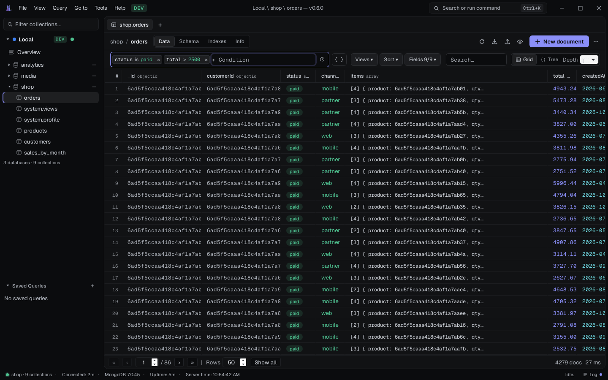
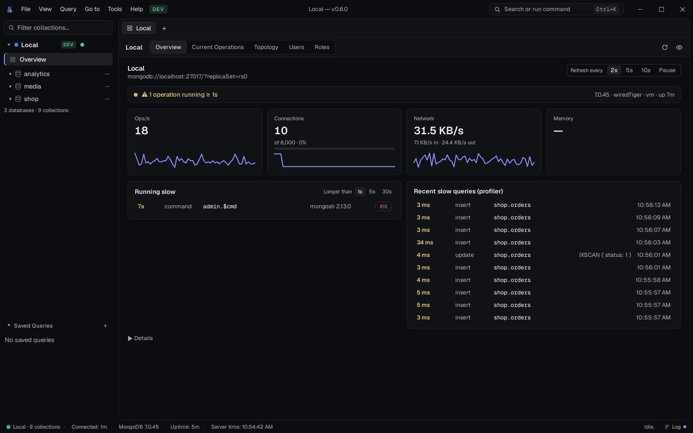
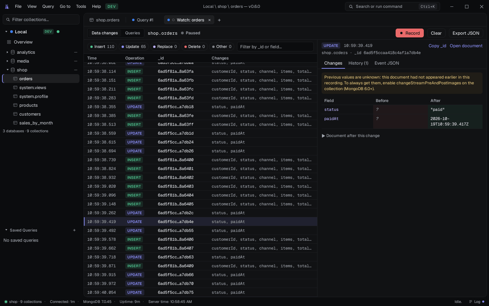
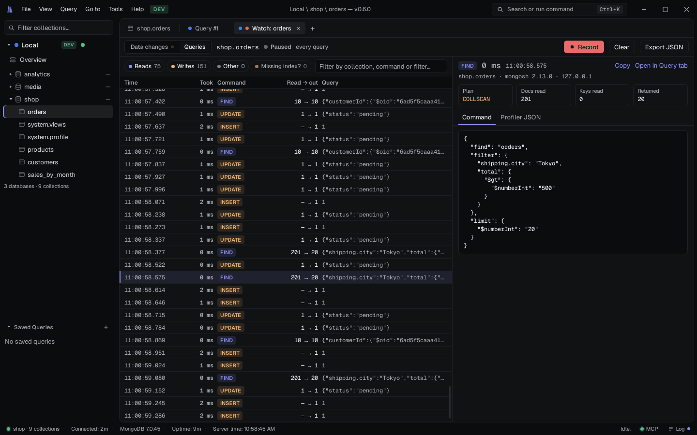
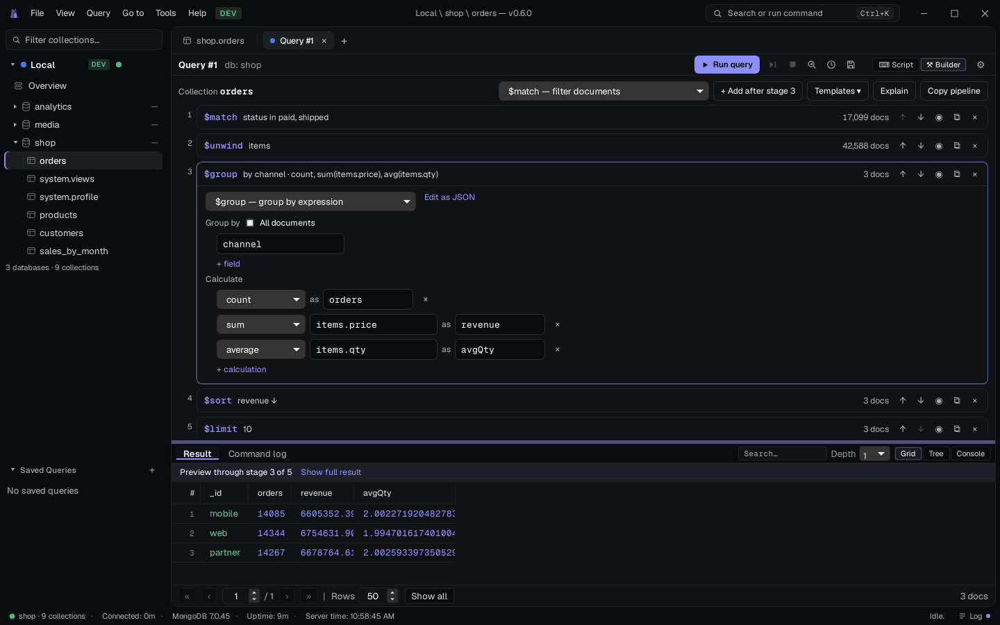
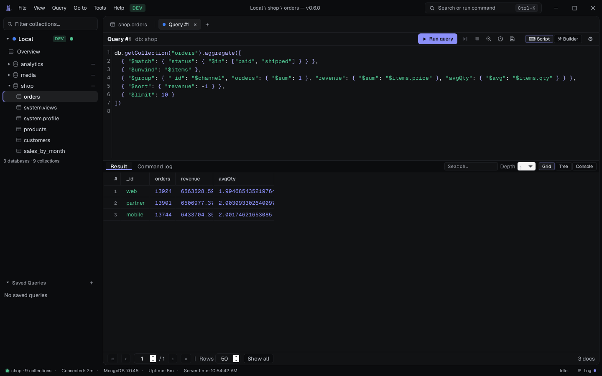
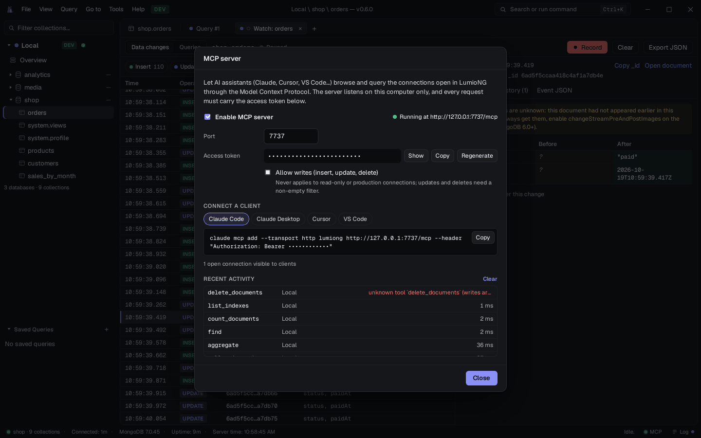

<p align="center">
  
</p>

<h1 align="center">LumioNG — Free, Fast MongoDB GUI for Windows, macOS and Linux</h1>

<p align="center">
  <strong>An open-source MongoDB GUI client</strong> with a spreadsheet-style data grid, a visual
  aggregation pipeline builder, a mongosh-style query console, live server monitoring and built-in
  AI access through MCP.<br>
  Lightweight (Rust + Tauri, no bundled Chromium), free for commercial use, no account, no telemetry.
</p>

<p align="center">
  <a href="https://github.com/NGxxxx/lumioNG/releases/latest"><strong>Download</strong></a> ·
  <a href="#features">Features</a> ·
  <a href="docs/MCP.md">AI / MCP guide</a> ·
  <a href="#faq">FAQ</a> ·
  <a href="https://github.com/NGxxxx/lumioNG/issues">Report a bug</a> ·
  <a href="#support-development">Support ♥</a>
</p>

<p align="center">
  <a href="https://github.com/NGxxxx/lumioNG/releases/latest"></a>  <a href="LICENSE"></a>
  
  </p>

<p align="center">
  <picture>
    <source media="(prefers-color-scheme: light)" srcset="docs/assets/screenshots/data-grid-light.png">
    <source media="(prefers-color-scheme: dark)" srcset="docs/assets/screenshots/data-grid.png">
    
  </picture>
</p>

---

LumioNG is a **desktop MongoDB client** for developers and DBAs who want to browse, query, edit
and monitor MongoDB databases without a heavy IDE. It connects to local servers, replica sets,
sharded clusters and **MongoDB Atlas**, and is a free, open-source alternative to tools such as
MongoDB Compass, Studio 3T, NoSQLBooster and Robo 3T.

> [!NOTE]
> **LumioNG is in early development.** Some features may have bugs or not work in every setup yet. Your feedback shapes what gets fixed first — please
> [open an issue](https://github.com/NGxxxx/lumioNG/issues) when something breaks or feels wrong,
> or suggest what you would like to see.

## Why LumioNG

- **Pro features, free.** Tools that are often paid extras in other MongoDB GUIs — SSH tunnels,
  a visual aggregation builder, schema analysis, collection compare and sync, SQL import/export,
  live monitoring, an audit log — are all included, with no Pro tier, no trial and no feature limits.
- **Light and fast.** A Rust core on the operating system's own webview (Tauri): no bundled
  Chromium, no JVM, a small download. The grid virtualizes rows *and* columns, so result sets with
  tens of thousands of documents still scroll smoothly.
- **Table-first.** Documents read like a spreadsheet: typed columns, nested fields flattened to the
  depth you choose, inline editing and filter chips you type like `status:paid total>2500`.
- **See what the server is doing.** A live dashboard, slow-query profiler, change-stream viewer and
  current-operation killer are built in, so day-to-day work needs no separate monitoring tool.
- **Safe by default.** Environment labels (DEV / STAGING / PROD) with confirmations scaled to the
  risk, read-only connections, review-before-save for cell edits and undo for the last write.
- **AI-ready.** A built-in MCP server lets Claude, Cursor or VS Code query the connections you have
  open: local, token-protected and read-only unless you allow writes per connection, never on production.
- **Private.** No account, no sign-up, no telemetry. Passwords live in the OS keychain.

## Download

Get the latest version from the **[Releases page](https://github.com/NGxxxx/lumioNG/releases/latest)**.
Every release has an installer and a portable (no-install) build for each platform:

| Platform | Installer | Portable |
|---|---|---|
| **Windows 10 / 11** (x64) | `.exe` (setup) or `.msi` | `.zip` — unzip and run `LumioNG.exe` |
| **macOS** (Apple Silicon and Intel) | `.dmg` | `.app.zip` |
| **Linux** (x64) | `.deb` (Debian, Ubuntu, Mint) · `.rpm` (Fedora, RHEL, openSUSE) | `.AppImage` |

The builds are not code-signed yet. On Windows, choose **More info → Run anyway** in SmartScreen.
On macOS, right-click the app and choose **Open** the first time (or run
`xattr -cr /Applications/LumioNG.app` if macOS says it is damaged).

## Features

### Spreadsheet-style data grid

Browse a collection as a table with typed columns, sort, project, page and filter with chips or a
full mongosh filter. Edit cells inline (changes are reviewed before saving), bulk-edit, follow
`ObjectId` references to other collections and switch to a tree view for deeply nested documents.

### Live server dashboard

Operations per second, connections and network throughput as live sparklines, a health line,
operations running longer than a threshold (with one-click kill) and the most recent slow queries
from the profiler, refreshed every 2, 5 or 10 seconds.

<p align="center"></p>

### Watch changes and queries in real time

Open a change stream on a collection, a database or the whole deployment and see every insert,
update, replace and delete as it happens, with a field-level diff and each document's history.
The **Queries** view tails the profiler: how long each query took, the plan it used
(`IXSCAN` / `COLLSCAN`), documents read versus returned, and the full command.

<p align="center"></p>
<p align="center"></p>

### Visual aggregation pipeline builder

A two-way editor for `aggregate([...])`: every stage is a card with a plain-language summary and
the number of documents that survive it. Common stages (`$match`, `$group`, `$sort`, `$project`,
`$lookup`, `$unwind`, `$sample`, `$unset`…) open as forms; anything else stays editable as JSON.
Select a stage to preview the pipeline up to that point. Templates (top N, count per day, find
duplicates, join…), next-step suggestions and performance warnings are included.

<p align="center"></p>

### Query console (mongosh syntax)

A sandboxed JavaScript console with mongosh-style syntax for `find`, `aggregate`, writes, DDL and
admin commands, with autocomplete, explain plans, an index advisor, history, saved queries and a
command log. Supported methods are listed in [docs/MONGOSH_COMPAT.md](docs/MONGOSH_COMPAT.md).

<p align="center"></p>

### AI assistants through MCP

Turn on **Tools → MCP server** and any MCP client can list your open connections, sample a
collection's schema, and run `find`, `aggregate`, `count` or `explain` against them. The settings
dialog gives a copy-paste snippet for Claude Code, Claude Desktop, Cursor and VS Code, and shows
every tool call as it happens. See the [MCP guide](docs/MCP.md).

<p align="center"></p>

### Everything else you need daily

| | |
|---|---|
| **Connections** | Saved profiles with passwords in the OS keychain (or sealed by a master password when there is none), SSH tunnels with host-key verification, HTTP / SOCKS5 proxies, SCRAM / X.509 / LDAP / Kerberos / AWS IAM / OIDC authentication, step-by-step connection diagnosis, several sessions side by side |
| **Data** | Grid and tree views, inline and bulk editing, quick-look drawer, follow references between collections, saved views |
| **Schema & indexes** | Sampled schema with types and presence, database relationship diagram with inferred references, visual `$jsonSchema` validator editor, index management with usage stats and an index advisor for slow queries |
| **Import / export** | JSON, JSONL, CSV, BSON and SQL, streamed with progress and cancel; import several files or a whole folder (e.g. a mongodump database directory) in one go |
| **Compare & sync** | Diff two collections (even across clusters) by key and sync one into the other, with a dry run first |
| **GridFS** | Browse buckets, preview images, text and PDFs, download files |
| **Security** | Hash-chained audit log of writes, client-side field level encryption (opt-in build), master-password vault, redacted diagnostics export |
| **MongoDB Atlas** | Browse projects and clusters with a service account; manage Atlas Search and Vector Search indexes |
| **Admin** | Create / rename / duplicate / truncate / drop, users and roles, replica-set and sharding status, current operations |
| **Comfort** | Command palette (`Ctrl/⌘ K`), keyboard shortcuts, light and dark themes, UI size and density, English and Vietnamese |
| **Window** | Remembers size, position and maximized state, and offers to reopen your last tabs (production connections ask first). *View → Use system window frame* switches to the native title bar |

## FAQ

**Is LumioNG free?**
Yes. Every feature is free on every connection, including at work, with no trial, no time limit and
no account. There is no paid "Pro" edition: advanced features are part of the free app. The project is funded by voluntary donations on [Ko-fi](https://ko-fi.com/ngxxxx) and
[GitHub Sponsors](https://github.com/sponsors/NGxxxx).

**Which MongoDB versions does it support?**
MongoDB 4.2 and newer: standalone servers, replica sets, sharded clusters and MongoDB Atlas.

**Does it work with MongoDB Atlas?**
Yes. Paste your `mongodb+srv://` connection string. With an Atlas service account you can also
browse projects and clusters and manage Atlas Search indexes.

**Does LumioNG send any data anywhere?**
No. There is no telemetry and no account. The app only connects to the servers you configure (and
to your identity provider or the Atlas Admin API when you use those features).

**How is it different from MongoDB Compass?**
LumioNG focuses on a fast, table-first workflow: a virtualized grid for large result sets,
inline editing with review, a mongosh-style console, live monitoring and an MCP server for AI
assistants, in a lightweight native app.

**Is it stable?**
LumioNG is in early development. Core browsing, querying and editing are the most tested; newer or
less common features (some auth methods, Atlas, CSFLE, compare and sync) have had less real-world
testing. Back up important data before bulk writes, use read-only connections for production, and
please [report anything that breaks](https://github.com/NGxxxx/lumioNG/issues).

**Can I use it with AI assistants like Claude or Cursor?**
Yes, through the built-in MCP server. Access is per connection, read-only by default and never
allowed on connections labelled production. See the [MCP guide](docs/MCP.md).

## Build from source

Prerequisites: [Node.js](https://nodejs.org/) 20+, [Rust](https://www.rust-lang.org/tools/install)
(stable) and the [Tauri prerequisites](https://tauri.app/start/prerequisites/) for your OS (on Linux:
WebKitGTK 4.1, i.e. Ubuntu 22.04+ or equivalent).

```sh
npm install
npm run tauri dev     # run in development
npm run tauri build   # build the installers for the current OS
```

Release builds for all three platforms are produced by GitHub Actions
([`.github/workflows/release.yml`](.github/workflows/release.yml)) when a `vX.Y.Z` tag is pushed.

<details>
<summary><strong>Kerberos (GSSAPI) authentication</strong></summary>

The `gssapi-auth` driver feature is on by default on Linux and Windows (see `src-tauri/Cargo.toml`):

- **Linux** links the system Kerberos library. To build you need `libkrb5-dev`, `libclang-dev` and
  `pkg-config` (Debian/Ubuntu: `sudo apt install libkrb5-dev libclang-dev pkg-config`). At runtime the
  app needs `libgssapi_krb5.so.2` (package `libgssapi-krb5-2` on Debian/Ubuntu, `krb5-libs` on Fedora);
  the `.deb` and `.rpm` packages declare it as a dependency.
- **Windows** uses the built-in SSPI, so nothing extra is needed.
- **macOS** is built without Kerberos (the GSS framework build has not been verified), so GSSAPI
  authentication is unavailable there.

</details>

<details>
<summary><strong>Client-side field level encryption (libmongocrypt)</strong></summary>

Encryption support is **opt-in**: a plain `cargo build` / `npm run tauri build` needs no native library and
the Encryption tab is hidden. To include it, build with the `csfle` Cargo feature. That links the native
[libmongocrypt](https://github.com/mongodb/libmongocrypt) library, which the `mongocrypt-sys` crate does
not build for you. Build it once (CMake and a C compiler; OpenSSL headers on Linux), install it where
the linker and the loader find it, and point `MONGOCRYPT_LIB_DIR` at it:

```sh
git clone --branch 1.18.2 https://github.com/mongodb/libmongocrypt.git
cmake -S libmongocrypt -B libmongocrypt/build -DCMAKE_BUILD_TYPE=Release -DENABLE_ONLINE_TESTS=OFF \
  -DBUILD_TESTING=OFF -DCMAKE_INSTALL_PREFIX=/usr/local
cmake --build libmongocrypt/build --target install && sudo ldconfig
export MONGOCRYPT_LIB_DIR=/usr/local/lib
npm run tauri build -- --features csfle      # or: cargo build --features csfle
```

A build with the feature needs `libmongocrypt.so.0` and `libkms_message.so.0` (`mongocrypt.dll` on Windows)
next to the app at run time, so **release bundles must ship the library** (or link it statically with a
Cargo `links` override). Builds without the feature have no such dependency. The feature has been
exercised on Linux only; Windows and macOS are not verified. The official release builds do not
include it.

</details>

## Development

```sh
npm test                                          # frontend unit and component tests (Vitest)
npm run check                                     # svelte-check: 0 errors, 0 warnings
cargo test --manifest-path src-tauri/Cargo.toml   # backend tests
```

Tests that need a real MongoDB are marked `#[ignore]`; run them against a disposable server with
`LUMIO_TEST_MONGO_URI=mongodb://localhost:27017 cargo test --manifest-path src-tauri/Cargo.toml -- --ignored`.

| Layer | Choice |
|---|---|
| Shell | Tauri 2 — Rust backend, native webview (WebView2 / WebKitGTK / WKWebView) |
| Frontend | SvelteKit + Svelte 5 (runes) + TypeScript |
| Data grid | Custom table on TanStack Virtual (row and column virtualization) |
| Editor | CodeMirror 6 |
| Driver | Official `mongodb` Rust crate |

Rust stays thin — connect, query, serialize to Canonical Extended JSON — and all display logic lives
in Svelte. The architecture is described in [docs/ARCHITECTURE.md](docs/ARCHITECTURE.md); coding
conventions are in [CLAUDE.md](CLAUDE.md).

## Documentation

| Document | Contents |
|---|---|
| [docs/ARCHITECTURE.md](docs/ARCHITECTURE.md) | Runtimes, IPC contract, frontend layering, feature flows |
| [docs/MCP.md](docs/MCP.md) | Connecting AI assistants through the built-in MCP server |
| [docs/MONGOSH_COMPAT.md](docs/MONGOSH_COMPAT.md) | mongosh methods supported by the query console |
| [CONTRIBUTING.md](CONTRIBUTING.md) | Bug reports, feature requests, pull requests |
| [LICENSING.md](LICENSING.md) | License, funding, trademarks |
| [SECURITY.md](SECURITY.md) | Reporting a vulnerability privately |

## Support development

LumioNG is free and built in spare time. If it is useful to you:

- **[Buy me a coffee on Ko-fi](https://ko-fi.com/ngxxxx)** — a one-time tip by card or PayPal,
  no account needed.
- **[Sponsor on GitHub](https://github.com/sponsors/NGxxxx)** — one-time or monthly, the easiest
  way for companies to support the project.
- **Star the repository** — it helps other people find LumioNG.
- Report bugs, suggest features or share it with your team.

Donations never unlock features: everyone gets the same app.

<p>
  <a href="https://ko-fi.com/ngxxxx"></a>
  <a href="https://github.com/sponsors/NGxxxx"></a>
</p>

## Contact

- Bugs and feature requests: [GitHub issues](https://github.com/NGxxxx/lumioNG/issues)
- Security vulnerabilities: see [SECURITY.md](SECURITY.md)
- Everything else: [ngx.giang@proton.me](mailto:ngx.giang@proton.me)

## Contributing

Bug reports, feature requests and pull requests are welcome — read [CONTRIBUTING.md](CONTRIBUTING.md)
first. Contributions are licensed under the AGPL v3.0.

## License

LumioNG is licensed under the [GNU Affero General Public License v3.0 only](LICENSE)
(`AGPL-3.0-only`). Third-party components keep their own licenses, listed in [NOTICE](NOTICE).

Copyright © 2025-2026 NG and LumioNG contributors. MongoDB is a trademark of MongoDB, Inc.; LumioNG
is an independent project and is not affiliated with or endorsed by MongoDB, Inc. Other product
names are trademarks of their respective owners.
