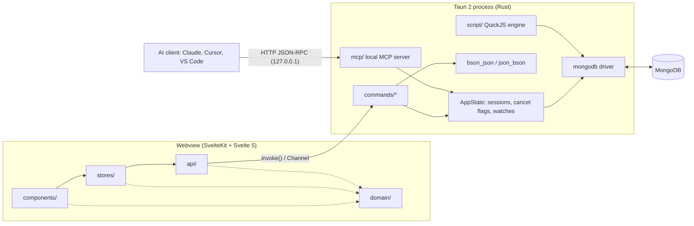
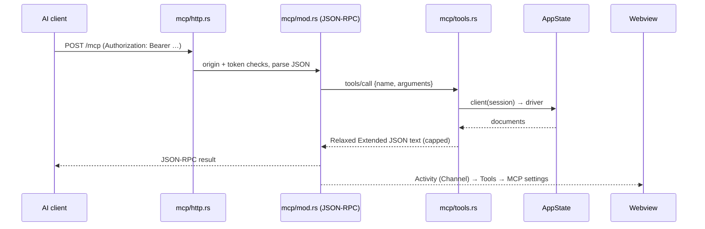

# LumioNG Architecture

This document describes how LumioNG is put together: the two runtimes, the contract between them,
how the frontend is layered, and how the main features (query console, pipeline builder, import /
export, change streams, the built-in MCP server) flow through those layers. The day-to-day coding
rules live in [`CLAUDE.md`](../CLAUDE.md); this is the map.

## 1. Big picture



Two processes, one rule: **Rust stays thin.** It connects, runs the operation, serializes the
result and returns a string. Everything about *display* — columns, formatting, diffing, type
inference for the grid, undo — happens in the webview.

| Concern | Lives in | Why |
|---|---|---|
| Connections, SSH tunnels, TLS, auth | Rust (`commands/connection.rs`, `ssh_tunnel.rs`) | needs sockets and the official driver |
| Running queries / commands / scripts | Rust (`commands/*`, `script/`) | driver access, cancellation, timeouts |
| BSON ⇄ JSON conversion | Rust (`bson_json.rs`, `json_bson.rs`) | lossless type round-trip |
| Columns, cells, trees, filters, forms | Svelte (`domain/`, `components/`) | UI concerns, unit-testable without a server |
| Persistence of preferences | `localStorage` via stores | per-user UI state |
| Persistence of connections / saved queries | Rust (`registry.rs`, `query_library.rs`) in the app config dir | survives reinstalls of the webview cache |
| Saved passwords and passphrases | OS credential store via `secrets.rs` (Keychain / Credential Manager / Secret Service) | never written to disk in the app's own files when a store is available |

## 2. The contract: Canonical Extended JSON

Every document crossing the IPC boundary is a **Canonical Extended JSON** string
(`{"$oid": …}`, `{"$date": {"$numberLong": …}}`, `{"$numberDecimal": …}`…). Canonical (not
Relaxed) is used because it is lossless: an `Int64` stays an `Int64`, a `Decimal128` keeps its
precision, and a document edited in the grid is written back with the same BSON types it was read
with.

- **Rust → webview:** `bson_json::doc_to_raw` / `bson_to_raw` produce `RawValue`s, so a page of
  documents is sent as pre-serialized JSON without a second encode.
- **webview → Rust:** filters, sorts, pipelines and documents arrive as Extended JSON strings and are
  parsed by `json_bson::canonical_string_to_*`.
- Round-trip tests for every BSON type guard this edge (`bson_json.rs`, `json_bson.rs`,
  `domain/extjson.test.ts`, `domain/bsonnum.test.ts`).

## 3. Frontend layering

```
src/lib/
  api/          the ONLY place that calls invoke(); one file per command group
  domain/       pure TypeScript: parsing, transforms, inference, planning — no Svelte, no Tauri
  stores/       state + actions as factories (createX) built on Svelte 5 runes
  components/   rendering and DOM glue only
```

Dependencies only point one way: `components → stores → api`, and any layer may use `domain`.
`domain` never imports upward. Consequences that keep the codebase fast to work in:

- **Pure logic is tested in Node** (Vitest, no DOM) — the bulk of the ~2 000 frontend tests.
- **Stores are tested by mocking `api/`** (`vi.mock("../api/…")`) — no Tauri needed.
- **Components are tested in jsdom** with Testing Library, against mocked stores/api.

### State and memory

- Stores are factories returning getters (read) and functions (actions); singletons are exported
  where the app needs one instance (`settings`, `theme`, `sessionManager`, `mcp`…).
- **Large document arrays use `$state.raw`**, never deep `$state`: a deep proxy per field turns
  25 000 documents into millions of signals. Updates are immutable (build a new array, reassign).
- The data grid virtualizes **rows and columns** (TanStack Virtual), so render cost depends on the
  viewport, not on the result size.

### Sessions and tabs

`stores/sessionManager.svelte.ts` owns the open sessions (one per live connection, each with its
own namespace tree, host status and navigation) and the work tabs (Query, Document, Watch). Context
tabs (Host / Database / Collection) follow the tree selection; work tabs are free-form and bound to
the session they were opened from.

## 4. Backend structure

```
src-tauri/src/
  lib.rs            app builder: managed state + every command in generate_handler!
  state.rs          AppState: sessions (client, read-only flag, SSH tunnel), cancel flags, watches
  error.rs          AppError → { kind, message } for the frontend; no unwrap in the command layer
  bson_json.rs      BSON → Canonical Extended JSON
  json_bson.rs      Canonical Extended JSON → BSON
  registry.rs       saved connection profiles (connections.json)
  secrets.rs        connection secrets in the OS credential store
  commands/         #[tauri::command]s grouped by domain
    connection.rs   connect / disconnect / namespaces / saved profiles / SSH host keys
    query.rs        find pages, aggregate, count, distinct, explain
    mutation.rs     insert / replace / update / delete (one and many)
    admin.rs index.rs users.rs server.rs stats.rs   DDL, indexes, users & roles, server status
    import_export.rs csv.rs sql.rs gridfs.rs         streamed jobs with progress Channels
    script.rs       runs the query console through the QuickJS engine
    watch.rs profiler.rs                             change streams, live profiler
    mcp.rs          on/off + session list for the built-in MCP server
  script/           sandboxed JavaScript (rquickjs) with a mongosh-like host API
  mcp/              local MCP server (HTTP transport + tool implementations)
  *_import.rs *_export.rs *_stream.rs   format-specific streaming readers/writers
```

Conventions:

- Get a client with `state.client(session_id).await?`; write commands use
  `state.writable_client(…)`, which enforces the connection's read-only flag server-side.
- Long operations take a **cancel flag** scoped per session (`CancelScope::Interactive` for grid /
  console work, `CancelScope::Job` for imports, exports and downloads) so Stop in one place never
  aborts the other.
- Streaming work (exports, imports, change streams, MCP activity) reports through
  `tauri::ipc::Channel`s, batched to avoid one IPC message per event.

## 5. Feature flows

### Query console

The Query tab's editor holds a mongosh-style script. `commands/script.rs` runs it in a fresh QuickJS
context (`script/engine.rs`) whose host functions (`script/host/*`) map `db.coll.find(…)`,
`aggregate`, writes and admin helpers onto the driver, honouring the session's read-only flag, a
timeout and the cancel flag. The outcome (documents, counts, write results, printed output) comes
back as one structured value that `domain/scriptOutcome.ts` turns into result tabs.

### Pipeline builder

The builder (`components/builder/*`, `stores/pipelineTree.svelte.ts`) is a two-way view of an
`aggregate([...])` script:

- `domain/pipelineStages.ts` parses the script into stages and regenerates it after every edit.
- Each stage type with a form has a **codec** in `domain/stageForms/` (`parse` / `build` /
  `summarize`). A codec only accepts bodies it can rebuild *exactly*; anything else falls back to the
  JSON editor, so the builder never silently rewrites a pipeline.
- Each card shows how many documents survive it (a `$count` over the pipeline prefix) and selecting a
  card previews the pipeline up to that stage. Stages that write (`$out`, `$merge`) are never run by
  previews or counts.
- Templates (`stageForms/templates.ts`), next-step suggestions (`nextSteps.ts`) and warnings
  (`warnings.ts`) are pure functions with their own tests.

### Import / export

Exports and imports are jobs (`stores/jobs.svelte.ts`) that stream through Rust in chunks, report
progress over a Channel, and can be cancelled. Formats: JSON / JSONL, CSV, BSON (mongodump-compatible
`.bson`), and SQL `INSERT` statements.

### Change streams and profiler

The Watch tab opens a change stream (collection, database or deployment) or tails the profiler, and
receives batched events over a Channel until it is stopped or its session closes.

### Saved connection secrets

Profiles live in `connections.json`; their secrets (password, certificate-key password, SSH
password, SSH key passphrase) live in the OS credential store — macOS Keychain, Windows Credential
Manager, or the Secret Service on Linux (gnome-keyring, KWallet) — one credential per connection
(service `LumioNG`, account `connection-<id>`), through the `keyring` crate.

- **Transparent to the frontend:** the registry commands fill the secrets back in on load and take
  them out on save (`secrets::fill` / `secrets::sync`), so the IPC contract is unchanged. A profile
  carries `secretsInKeychain` so the file says where its secrets are.
- **Migration:** a file written by an older version is moved to the store on first load.
- **Fallback:** with no usable store (no Secret Service, unlock prompt dismissed, store locked),
  secrets stay in the file, sealed by the master-password vault (`vault.rs`) once it is set up and
  obfuscated until then; after the first failure the store is left alone
  until the next launch so the user isn't prompted on every action. A credential that can't be read
  is never deleted by an unrelated save. The connection form shows which mode is active.

## 6. Built-in MCP server

LumioNG can act as a **Model Context Protocol** server so an AI assistant can explore and query the
connections the user already has open. It is off by default and toggled from **Tools → MCP server**.



- **Transport:** MCP Streamable HTTP in its JSON-response form — `POST /mcp` with one JSON-RPC
  message (or a batch), `202` for notifications, `405` for `GET`/`DELETE` (no server-initiated
  stream, no stateful sessions). Protocol versions `2025-06-18`, `2025-03-26` and `2024-11-05` are
  negotiated. It is a deliberately small hand-written HTTP/1.1 reader (`mcp/http.rs`) — one request
  per connection, `Content-Length` bodies, size and time limits — so the feature adds no
  dependencies.
- **Security:** binds `127.0.0.1` only; every request needs the bearer token (constant-time
  compare); a browser `Origin` that is not local is refused (DNS-rebinding guard).
- **What is exposed:** only connections that are open in the app, as the frontend lists them
  (`mcp_set_sessions`), addressed by id or label.
- **Tools:** `list_connections`, `list_databases`, `list_collections`, `find`, `aggregate`,
  `count_documents`, `collection_schema`, `list_indexes`; with **Allow writes** on, also
  `insert_documents`, `update_documents`, `delete_documents`. Writes are refused on read-only
  connections and on connections labelled *production*, and updates / deletes require a non-empty
  filter. `$out` / `$merge` count as writes.
- **Limits:** at most 100 documents per call, a 30 s server-side `maxTimeMS`, and output capped at
  200 KB with a note telling the model to narrow its query.

See [`MCP.md`](MCP.md) for setup instructions per client.

## 7. Testing

| Gate | Command | Scope |
|---|---|---|
| Frontend unit + component tests | `npm test` | Vitest; `node` project for domain/api/stores, `jsdom` for components |
| Type and Svelte checks | `npm run check` | svelte-check, target 0 errors / 0 warnings |
| Backend tests | `cargo test --manifest-path src-tauri/Cargo.toml` | conversions, parsers, script engine, MCP protocol + HTTP |
| Live-server tests (opt-in) | `cargo test --manifest-path src-tauri/Cargo.toml -- --ignored` | needs MongoDB at `LUMIO_TEST_MONGO_URI` (default `mongodb://localhost:27017`) |
